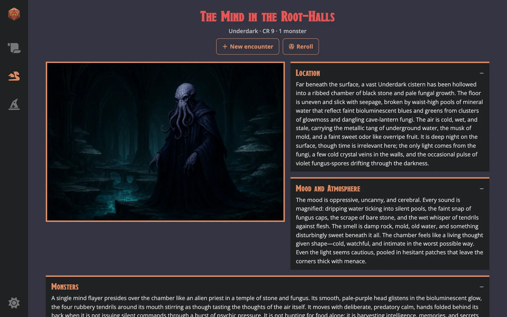
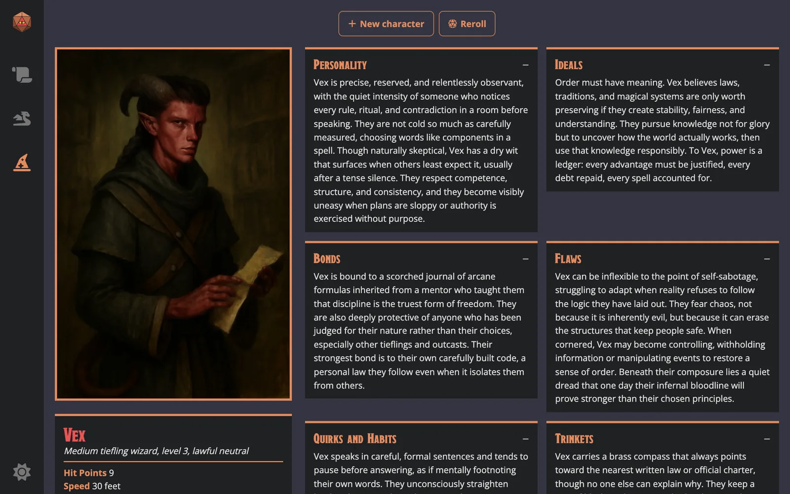
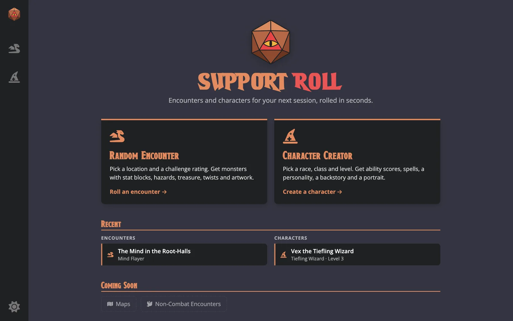
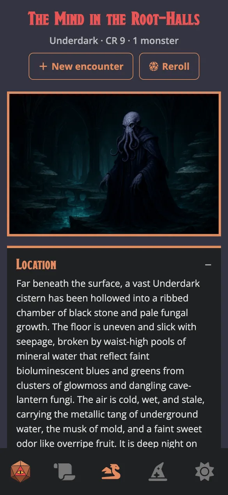
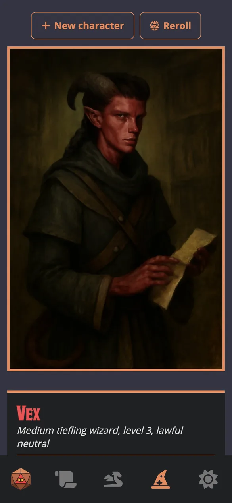

<h1 align="center">Support Roll</h1>

<p align="center">
  <strong>AI-powered encounters and characters for Dungeons &amp; Dragons Dungeon Masters.</strong>
</p>

<p align="center">
  <a href="https://supportroll.netlify.app"></a>
  <a href="https://github.com/trulstp/DNDAI/actions/workflows/ci.yml"></a>
</p>

<p align="center">
  <a href="https://supportroll.netlify.app"><strong>Try it live →</strong></a>
</p>



Pick a location and a challenge rating to roll a balanced combat encounter, or choose a race and class to generate a ready-to-play character. Support Roll combines rules-based numbers (a monster catalogue, SRD stat blocks and a character rules engine) with AI-written flavour text and AI-generated artwork.

> The backend runs on a free hosting plan and sleeps when idle, so the first request after a quiet spell can take up to a minute. The page says so when it happens.

<details>
<summary><strong>More screenshots</strong></summary>
<br>

| Character sheet | Home |
|---|---|
|  |  |

| Encounter on a phone | Character on a phone |
|---|---|
|  |  |

</details>

---

## Features

### 🐉 Random encounters
- **48 locations** (caves, the Underdark, graveyards, volcanoes, elven cities, …) and a **challenge rating from 1 to 24**.
- The backend picks a group of monsters native to that location whose combined CR fits the budget, usually led by a monster that matches it.
- The AI writes the encounter: location, monsters and their tactics, obstacles, allied NPCs, treasure, twists, and mood.
- **SRD stat blocks** for the monsters, ready to run at the table.
- **Generate artwork** paints the scene.

### 🧙 Character creator
- Choose a **name, race** (9), **class** (Cleric, Fighter, Rogue, Wizard) and **level** (1–3), or leave any of them random.
- A Python rules engine rolls the mechanics: ability scores, hit points, racial traits, skills, saving throws, equipment, languages and spells.
- The AI adds personality, ideals, bonds, flaws, trinkets, quirks and a backstory.
- **Generate portrait** paints the character.

### ✨ Throughout
- **History that survives reloads**, with **favourites** that are kept even when browser storage runs low.
- **Reroll** any result with the same choices.
- **Dark and light themes**, following the device setting by default.
- **Responsive**, with a bottom navigation bar on phones.
- **Accessible:** keyboard navigation, a skip link, screen-reader announcements for loading and errors, and WCAG AA colour contrast.

---

## Tech stack

| Layer | Technology |
|---|---|
| Frontend | React 18, Vite, React Router 6, CSS Modules, Font Awesome |
| Backend | Node.js 24, Express 4, Mongoose 7 |
| Database | MongoDB (monster catalogue, SRD stat blocks, daily usage) |
| AI | OpenAI Chat Completions with tool calling for structured JSON; OpenAI Images (`gpt-image-1-mini`) |
| Image processing | `sharp`: AVIF, with WebP for browsers without AVIF support |
| Character rules engine | Python 3 |
| Hosting | Netlify (frontend), Render with Docker (backend), MongoDB Atlas (database) |
| CI | GitHub Actions: backend tests, frontend build, Docker image check |

---

## How it works

```
┌──────────────┐   1. location + CR    ┌──────────────┐   query    ┌─────────────┐
│              │ ────────────────────▶ │              │ ─────────▶ │   MongoDB   │
│    React     │ ◀──── monster list ── │   Express    │ ◀───────── │  monsters,  │
│   frontend   │                       │   backend    │            │ stat blocks │
│              │   2. monsters +       │              │  tool      └─────────────┘
│              │      location ──────▶ │              │  calling ─▶ ┌──────────┐
│              │ ◀── encounter JSON ── │              │ ◀────────── │  OpenAI  │
│              │   3. signed image     │              │             │          │
│              │      prompt ────────▶ │              │ ──────────▶ │  Images  │
│              │ ◀── AVIF/WebP image ─ │   (sharp)    │ ◀────────── │          │
└──────────────┘                       └──────┬───────┘             └──────────┘
                                              │ spawn
                                       ┌──────▼───────┐
                                       │    Python    │  character mechanics
                                       │ rules engine │  (stats, HP, spells…)
                                       └──────────────┘
```

### Protecting the AI routes
The routes that call OpenAI cost money, so a public deployment needs guarding:
- **Request checks.** Locations, races, classes and the other fields must be values the app itself sends, so free text can't be slipped into the prompts. Bodies over 20 KB are refused.
- **Signed image prompts.** The server signs each image description it writes (HMAC-SHA256), and the image routes only draw descriptions with a valid signature, so they can't be used as a general-purpose image generator.
- **Rate limits.** Each visitor gets a number of AI requests per hour, and all visitors together a daily budget counted in MongoDB. Behind Cloudflare, visitors are identified by the `CF-Connecting-IP` header, which can't be spoofed. Rejected requests don't count.
- **Graceful failure.** OpenAI calls time out, errors never include internal details, and the page explains when the server is waking up or the AI budget is used up.

---

## Getting started

### Prerequisites
- [Node.js](https://nodejs.org/) 24 (with nvm, run `nvm use` in the repo to pick it up from `.nvmrc`)
- [Python 3](https://www.python.org/), available as `python3`
- A [MongoDB](https://www.mongodb.com/) database (local or Atlas)
- An [OpenAI API key](https://platform.openai.com/api-keys)

### 1. Backend
```bash
git clone https://github.com/trulstp/DNDAI.git
cd DNDAI/backend
npm install
```

Create `backend/.env`:
```env
DATABASE_ACCESS=mongodb+srv://<user>:<password>@<cluster>/<db>
OPENAI_API_KEY=sk-...
PORT=4000
```

Load the monster catalogue (safe to re-run), copy the SRD stat blocks from Open5e, and start the server:
```bash
node scripts/seedMonsters.js
node scripts/syncOpen5e.js
npm start            # or: npm run dev, which restarts on changes
```
The API is now at `http://localhost:4000`. Run the tests with `npm test`.

### 2. Frontend
```bash
cd ../frontend
npm install
npm start
```
Open [http://localhost:3000](http://localhost:3000). The frontend calls `http://localhost:4000` unless `VITE_API_BASE_URL` is set in `frontend/.env`.

### 3. Docker (optional)
The backend is hosted as a Docker image with Node 24 and Python 3 bundled:
```bash
cd backend
docker build -t supportroll-backend .
docker run --env-file .env -p 4000:4000 supportroll-backend
```
Docker's `--env-file` needs `KEY=value` lines without spaces around the `=`.

---

## Configuration

Optional backend settings, mostly for a deployed server:

| Variable | Default | What it does |
|---|---|---|
| `CORS_ORIGINS` | `http://localhost:3000,https://supportroll.netlify.app` | Sites allowed to call the API, comma separated |
| `AI_LIMIT_PER_HOUR` | `20` | AI requests per visitor per hour. An encounter or character with artwork is two |
| `AI_LIMIT_PER_DAY` | `150` | AI requests per day for all visitors together |
| `CLIENT_IP_HEADER` | not set | Header with the visitor's IP, set by the proxy in front, e.g. `CF-Connecting-IP` behind Cloudflare (Render) |
| `TRUST_PROXY` | `0` | Number of proxies in front of the server, used when `CLIENT_IP_HEADER` isn't set |
| `DEBUG_CLIENT_IP` | `false` | `true` adds `GET /debug/client-ip`, showing which IP the rate limits see. For setting up a host only |
| `PROMPT_SIGNING_SECRET` | derived from `OPENAI_API_KEY` | Key for signing image prompts |
| `USE_HTTPS`, `SSL_KEY_PATH`, `SSL_CERT_PATH` | `false` | Serve HTTPS directly, for hosts that don't provide it |

---

## API

All endpoints are under `/app`, except `GET /health`, which reports `{ "status": "ok", "database": "connected" }` for the host's health checks.

| Method | Endpoint | Description |
|---|---|---|
| `GET` | `/encounter?location=underdark&challengeRating=9` | Random monster group that fits the CR budget |
| `GET` | `/statblocks?names=Wraith,Mummy` | SRD stat blocks by monster name |
| `POST` | `/create-character` | `{ name, race, classType, level }` → character mechanics |
| `POST` | `/schematic` | `{ message: { monsters, location, challengeRating } }` → encounter JSON with `poster_signature` |
| `POST` | `/openaiCharacter` | `{ message: { name, race, class, level, alignment, stats, skills } }` → personality and backstory with `portrait_signature` |
| `POST` | `/images` | `{ message, signature, format }` → landscape image (1536×1024), `format` is `avif` (default) or `webp` |
| `POST` | `/images2` | `{ message, signature, race, characterClass, format }` → portrait image (1024×1536) |

---

## Project structure

```
DNDAI/
├── .github/workflows/ci.yml   # Tests, build and Docker check on every PR
├── backend/
│   ├── server.js · app.js     # Startup, database, Express app, /health
│   ├── routes/ · controller/  # Endpoints and their logic
│   ├── middleware/limits.js   # Rate limits and the daily AI budget
│   ├── util/promptSignature.js
│   ├── models/                # Monsters, stat blocks, usage
│   ├── scripts/               # Python rules engine, seed and Open5e sync
│   ├── data/monsterSeed.js    # Monsters per location
│   ├── test/                  # npm test
│   └── Dockerfile
├── frontend/
│   ├── src/
│   │   ├── pages/             # Route-level pages
│   │   ├── Components/        # Nav, results, character sheet, inputs, UI kit
│   │   ├── store/             # History, favourites, theme
│   │   └── util/              # API access and small helpers
│   └── netlify.toml
└── docs/screenshots/
```

---

## Roadmap

- [ ] Non-combat encounters
- [ ] Map maker
- [ ] More classes and higher character levels

---

## Credits

This work includes material taken from the System Reference Document 5.1 ("SRD 5.1") by Wizards of the Coast LLC, available at <https://dnd.wizards.com/resources/systems-reference-document>. The SRD 5.1 is licensed under the [Creative Commons Attribution 4.0 International License](https://creativecommons.org/licenses/by/4.0/legalcode). Stat blocks are retrieved through the [Open5e](https://open5e.com/) API.

Encounter and character text and artwork are generated with OpenAI models.

## Author

**Truls Teige Pettersen**: [@trulstp](https://github.com/trulstp)

## Disclaimer

Support Roll is an unofficial fan project. *Dungeons & Dragons* is a trademark of Wizards of the Coast; this project is not affiliated with or endorsed by Wizards of the Coast.
